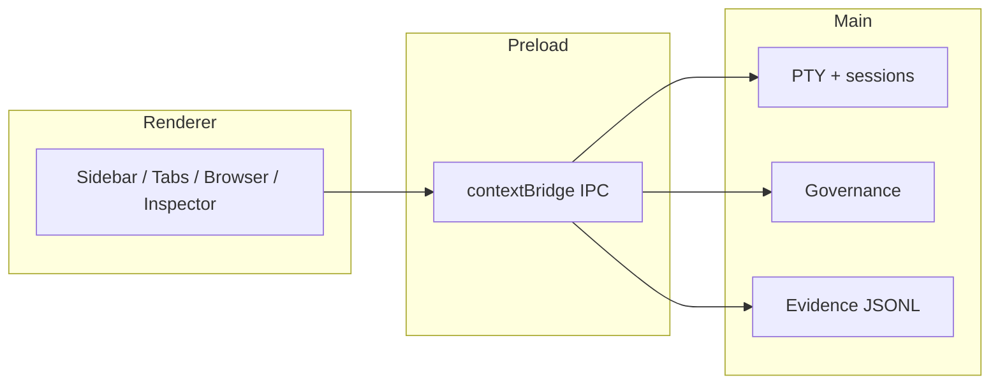

# Architecture

High-level map of Calder’s Electron layout. For guardrails and file-size policy, see [docs/architecture-guardrails.md](https://github.com/batu3384/calder/blob/main/docs/architecture-guardrails.md) in the repo.

## Process model

```text
src/
  main/       Electron main — PTY orchestration, providers, governance,
              hooks, IPC handlers, Session Evidence writer
  preload/    contextBridge APIs exposed to renderer (typed IPC surface)
  renderer/   UI — sidebar, tabs, terminal panes, browser, inspector
  shared/     Shared runtime types and contracts
```



## Session lifecycle

1. User opens or resumes a session → main spawns a PTY with the selected provider adapter.
2. Provider hooks (when configured) write status/events under `~/.calder/runtime/`.
3. Renderer subscribes via IPC; Context Inspector shows timeline, cost, and governance state.
4. Session Evidence (optional) appends redacted tool/governance events to `~/.calder/evidence/{runId}/`.

## Isolation boundary

Calder respects CLI vendor home directories. Summary from [docs/architecture/calder-isolation-boundary.md](https://github.com/batu3384/calder/blob/main/docs/architecture/calder-isolation-boundary.md):

| Writes allowed                        | Writes forbidden                                      |
| ------------------------------------- | ----------------------------------------------------- |
| `~/.calder/`                          | `~/.claude/`, `~/.codex/`, `~/.gemini/`, `~/.cursor/` |
| `<project>/.calder/`                  |                                                       |
| Electron `userData`                   |                                                       |
| Temp `calder-*` (screenshots, bridge) |                                                       |

**Conscious exceptions (user consent):** Provider Update Center installs system CLIs; mobile dependency doctor installs tooling.

Calder does **not** read provider MCP/skills/agents configs for display — each CLI loads its own config when the session runs.

## Browser → CLI routing

Inspect, Draw, and Flow surfaces call `deliverBrowserCapturePrompt` with governance context and an explicit session target. Cross-origin iframe interiors and closed shadow roots are platform limits, not Calder bugs — use Draw or parent-page context.

## Structure enforcement

CI and local pre-push run `npm run audit:structure`:

- Code files ≤ 500 lines; test files ≤ 1000; scripts ≤ 350
- Legacy oversized files frozen in `scripts/structure-audit-baseline.json`
- Forbidden tracked artifact paths blocked

## Security architecture

Renderer has no Node integration; all privileged operations go through preload IPC. See [Security](Security) and repo [docs/reports/security/](https://github.com/batu3384/calder/tree/main/docs/reports/security).

## Related repo docs

- [docs/architecture/session-evidence.md](https://github.com/batu3384/calder/blob/main/docs/architecture/session-evidence.md)
- [docs/development-workflow.md](https://github.com/batu3384/calder/blob/main/docs/development-workflow.md)
