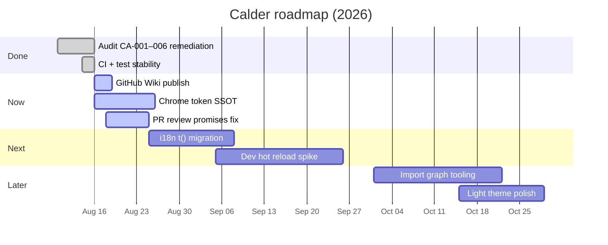

# Roadmap

Living plan derived from [README](https://github.com/batu3384/calder/blob/main/README.md), [docs/codebase-audit/2026-08-16.md](https://github.com/batu3384/calder/blob/main/docs/codebase-audit/2026-08-16.md), and shipped remediation — not a wishlist of unscoped features.

Track execution via [Issues](https://github.com/batu3384/calder/issues) and [Security Advisories](https://github.com/batu3384/calder/security/advisories). Security findings: **never** public issues — use the advisory flow in [Security](Security).

## Status legend

| Status    | Meaning                                     |
| --------- | ------------------------------------------- |
| **Done**  | Shipped on `main` or documented as complete |
| **Now**   | Active focus this sprint                    |
| **Next**  | Queued after current tranche                |
| **Later** | Valid direction, no committed date          |

## Done

| Item                                                   | Status | Notes                                                                |
| ------------------------------------------------------ | ------ | -------------------------------------------------------------------- |
| Bootstrap init order + early UI paint (CA-004, CA-006) | Done   | `appState.load()` before tab/sidebar mount; early `markUiReady()`    |
| Provider selector visibility (CA-001)                  | Done   | Show disabled “not installed” rows; registry metas without binary OK |
| i18n Save + reload path (CA-002)                       | Done   | Persist on Save; reload applies locale                               |
| i18n observer scope + reduced-motion Office (CA-003)   | Done   | Narrower observer; Pixel Office respects `prefers-reduced-motion`    |
| Chrome rail token alignment (CA-005 partial)           | Done   | Partial `--surface-*` wiring; full SSOT still in Now                 |
| `checkBinary` cache refresh (CA-016)                   | Done   | Stale cache only on `forceRefresh: true`                             |
| Architecture guardrails + pre-push gate                | Done   | `audit:structure`, line budgets, frozen baseline                     |
| Session Evidence + Pixel Office                        | Done   | Opt-in capture; inspector Office mode                                |
| CI stability                                           | Done   | Vitest suite green on `main` (Aug 2026)                              |
| Codebase audit 2026-08-16                              | Done   | Report + JSON in `docs/codebase-audit/`                              |

## Now

| Item                                      | Status | Notes                                                                |
| ----------------------------------------- | ------ | -------------------------------------------------------------------- |
| GitHub Wiki source + sync                 | Now    | `wiki/` + `scripts/sync-wiki.sh`                                     |
| Chrome CSS single SSOT (CA-005 remainder) | Now    | Reduce `chrome-rail.css` `!important` debt; align light theme tokens |
| PR review artefact promises (CA-007)      | Now    | Align `.github/workflows/pr-review-run.yml` with `promises.py` paths |

## Next

| Item                                    | Status | Notes                                                      |
| --------------------------------------- | ------ | ---------------------------------------------------------- |
| i18n `t()` migration — remaining gaps   | Next   | Retire `DIRECT_TRANSLATIONS` / DOM mutation for new UI     |
| Dev hot reload                          | Next   | README documents rebuild+restart today; improve inner loop |
| Preferences copy vs behavior (CA-011)   | Next   | “Interface refreshes” note matches TR+EN Save reload       |
| Tab bar CLI update panel icons (CA-013) | Next   | SVG parity with shell icon set                             |

## Later

| Item                                     | Status | Notes                                                                                       |
| ---------------------------------------- | ------ | ------------------------------------------------------------------------------------------- |
| Import graph / orphan tooling (CA-009)   | Later  | Audit sample truncated; no automated orphan gate yet                                        |
| Runtime smoke in audit pipeline (CA-010) | Later  | `runtime-check.py` static-only today                                                        |
| Light theme chrome polish                | Later  | Aurora/command-studio token cleanup if still redundant                                      |
| Prebuilt release cadence                 | Later  | Track [Releases](https://github.com/batu3384/calder/releases); checksum workflow documented |

## Timeline (approximate)

## How to propose changes

1. Open a [GitHub Issue](https://github.com/batu3384/calder/issues/new) with problem statement and acceptance criteria.
2. For security: [Security Advisory](https://github.com/batu3384/calder/security/advisories/new) only.
3. Maintainers update this page when scope shifts; run `./scripts/sync-wiki.sh` after editing `wiki/Roadmap.md`.
