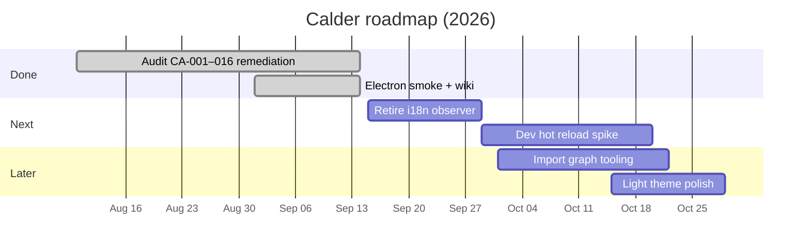

# Roadmap

Living plan derived from [README](https://github.com/batu3384/calder/blob/main/README.md), [docs/codebase-audit/2026-08-16.md](https://github.com/batu3384/calder/blob/main/docs/codebase-audit/2026-08-16.md), and shipped remediation — not a wishlist of unscoped features.

Track execution via [Issues](https://github.com/batu3384/calder/issues) and [Security Advisories](https://github.com/batu3384/calder/security/advisories). Security findings: **never** public issues — use the advisory flow in [Security](Security).

## Status legend

| Status    | Meaning                                     |
| --------- | ------------------------------------------- |
| **Done**  | Shipped on `main` or documented as complete |
| **Now**   | Active focus this sprint                    |
| **Next**  | Queued after current tranche                |
| **Later** | Valid direction, no committed date          |

## Done

| Item                                                   | Status | Notes                                                                                     |
| ------------------------------------------------------ | ------ | ----------------------------------------------------------------------------------------- |
| Bootstrap init order + early UI paint (CA-004, CA-006) | Done   | `appState.load()` before tab/sidebar mount; early `markUiReady()`                         |
| Provider selector visibility (CA-001)                  | Done   | Show disabled “not installed” rows; registry metas without binary OK                      |
| i18n Save + reload path (CA-002 persist)               | Done   | Persist on Save; reload applies locale                                                    |
| i18n `t()` chrome write sites (CA-002 remainder)       | Done   | Overlay, Live View, toast, menus, preferences layout/modal write through `t()`            |
| i18n observer scope + reduced-motion Office (CA-003)   | Done   | Rails/modal observers only; Pixel Office respects `prefers-reduced-motion`                |
| Chrome rail token alignment (CA-005)                   | Done   | `--chrome-bg` → `--surface-panel`; `!important` capped at 100 kill-bleed (theme-contract) |
| `checkBinary` cache refresh (CA-016)                   | Done   | Stale cache only on `forceRefresh: true`                                                  |
| Preferences language note (CA-011)                     | Done   | Copy names Save + reload                                                                  |
| Tab bar CLI update panel icons (CA-013)                | Done   | SVG paths, not unicode glyphs                                                             |
| Pixel Office facing controls (CA-008)                  | Done   | SVG arrows + `aria-label`                                                                 |
| Electron ui-ready smoke (CA-010)                       | Done   | `npm run smoke:electron`; CI `native-deps-smoke` on macOS                                 |
| PR review artefact promises (CA-007)                   | Done   | Workflow comments mark `pr-context/` and `review-body.md` as generated                    |
| GitHub Wiki source + sync                              | Done   | `wiki/` + `scripts/sync-wiki.sh`                                                          |
| Architecture guardrails + pre-push gate                | Done   | `audit:structure`, line budgets, frozen baseline                                          |
| Session Evidence + Pixel Office                        | Done   | Opt-in capture; inspector Office mode                                                     |
| CI stability                                           | Done   | Vitest suite green on `main`                                                              |
| Codebase audit 2026-08-16                              | Done   | Report + JSON in `docs/codebase-audit/`                                                   |

## Now

| Item | Status | Notes                                                            |
| ---- | ------ | ---------------------------------------------------------------- |
| —    | —      | No active sprint item. Next tranche starts from the table below. |

## Next

| Item                         | Status | Notes                                                                 |
| ---------------------------- | ------ | --------------------------------------------------------------------- |
| Retire i18n MutationObserver | Next   | `localizeDocument()` once on language apply; keep `t()` as write SSOT |
| Dev hot reload               | Next   | README documents rebuild+restart today; improve inner loop            |

## Later

| Item                                   | Status | Notes                                                                                       |
| -------------------------------------- | ------ | ------------------------------------------------------------------------------------------- |
| Import graph / orphan tooling (CA-009) | Later  | Audit sample truncated; no automated orphan gate yet                                        |
| Light theme chrome polish              | Later  | Aurora/command-studio token cleanup if still redundant                                      |
| Prebuilt release cadence               | Later  | Track [Releases](https://github.com/batu3384/calder/releases); checksum workflow documented |

## Timeline (approximate)

## How to propose changes

1. Open a [GitHub Issue](https://github.com/batu3384/calder/issues/new) with problem statement and acceptance criteria.
2. For security: [Security Advisory](https://github.com/batu3384/calder/security/advisories/new) only.
3. Maintainers update this page when scope shifts; run `./scripts/sync-wiki.sh` after editing `wiki/Roadmap.md`.
